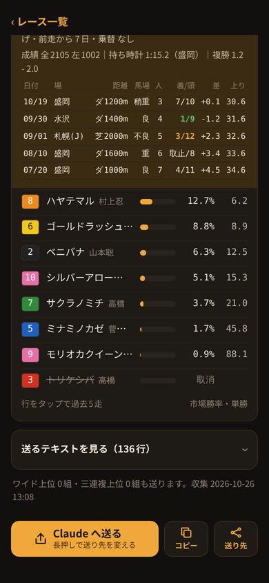

# 地方競馬データ収集（keiba-scraper）

地方競馬の1レース分の出馬表・オッズ・各馬の直近5走を集めて、AI（Claude など）に貼り付ける予想用のテキストを作るツールです。テキストには、決めた予算と期待値の下限で回収率の高い買い目を選ばせる指示文も入っています。

Android版の画面例です（馬名・オッズは試験用の架空のデータ）。

## Android版と PC版

集めるデータと AI への指示は同じです。ふだん使うなら Android版、予想の答え合わせをするなら PC版です。

| | Android版 | PC版 |
|---|---|---|
| 動く場所 | スマホだけ | Windows 11 + Python 3.10 以上 |
| AI への渡し方 | 共有メニューで AI アプリへ直接送る | クリップボードにコピーして貼り付ける |
| 予算・点数・期待値の下限 | 設定画面で変える | 定数を書き換える |
| 即PAT・A-PAT の発売 | 表示し、投票画面を開ける | — |
| 発走前の通知・自動収集 | あり | — |
| 予想の記録と答え合わせ | — | あり |

## はじめかた

**Android版**
1. スマホで次のリンクから `keiba-collector.apk` をダウンロードしてインストールする
   https://github.com/kotaooka/keiba-scraper/releases/download/android-latest/keiba-collector.apk
2. アプリを開き、レースをタップして収集する
3. 終わったら「送る」で AI アプリへ送る（最初だけ送り先を選ぶ）

**PC版**
1. `setup.bat` をダブルクリックする（初回だけ）
2. `run.bat` をダブルクリックし、レース日 → 競馬場 → レースを選ぶ
3. 取得が終わるとテキストがクリップボードに入るので、AI のチャット欄に貼り付ける

発走30分前以降に収集すると、締切に近いオッズで予想できます。

## 詳しい説明

| 知りたいこと | 文書 |
|---|---|
| Android版の画面ごとの使い方・更新 | [android/README.md](android/README.md) |
| PC版の使い方・記録と答え合わせ | [docs/pc.md](docs/pc.md) |
| AI へ送るテキストの中身・指示文・予算などの条件 | [docs/ai-text.md](docs/ai-text.md) |
| 直す人向け（ファイル構成・取れなくなったとき・ビルド） | [docs/development.md](docs/development.md) |

## 注意事項

- データの収集は個人で使う範囲にとどめ、各サイトの利用規約に従ってください。取得したデータは公開・配布しないでください。
- **連続実行・大量取得はしないでください。** 1回で予想に使う1レース分だけを取る前提のツールです。過去データの一括収集・ループ実行・複数の同時起動に使うと、サイトに負荷をかけ、利用規約違反やアクセス制限の対象になります。アクセスの間隔（2秒）も短くしないでください。
- 1レースで読むのは、netkeiba の出馬表・単勝複勝・ワイド・上位人気一覧と、keiba.go.jp の出馬表（馬柱）の各1ページです。このほか日付ごとに netkeiba の開催一覧を、Android版は月ごとに即PAT・A-PAT の発売カレンダー（keiba.go.jp）を1ページ読みます。
- keiba.go.jp の `robots.txt` は、Googlebot 以外のボットに `/KeibaWeb/TodayRaceInfo` 以下を Disallow とし、Crawl-delay 10秒を求めています。このツールは選んだ1レースにつきこの配下の出馬表を1回読むだけで、巡回はしません。
- 予想は参考情報です。馬券の購入は自己責任で行ってください。

## ライセンス

MIT License © 2026 KotaOoka
