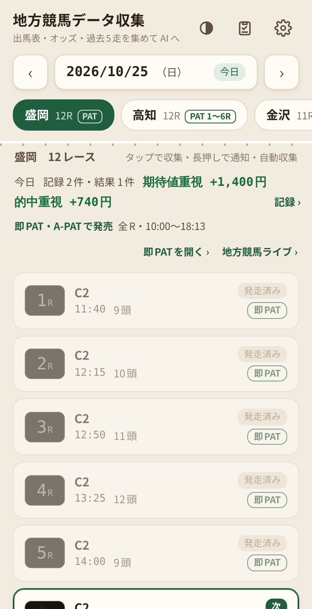
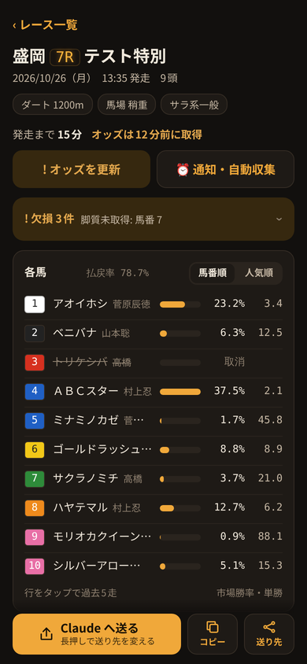
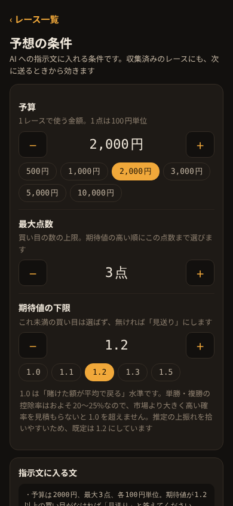
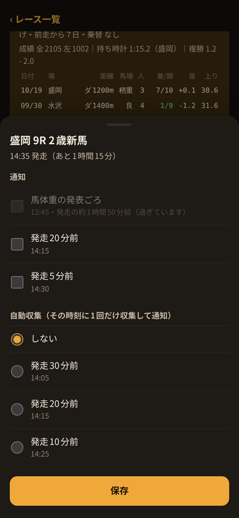

# 地方競馬データ収集（Android版）

[README に戻る](../README.md)

スマホだけで、レースを選ぶ → 収集 → AI アプリへ送る → 即PAT で投票、まで進められる Android アプリです。送るテキストの中身は [AI へ送るテキスト](../docs/ai-text.md)、注意事項は [README](../README.md#注意事項) を見てください。

必要なもの：Android 10 以上

## インストールと更新

1. スマホで次のリンクを開き、`keiba-collector.apk` をダウンロードしてインストールする（初回は「提供元不明のアプリ」の許可を求められる）
   https://github.com/kotaooka/keiba-scraper/releases/download/android-latest/keiba-collector.apk
2. 以降は「⋮」→「このアプリについて・更新」で、最新版との比較とアプリ内での更新ができる。新しい版があると一覧の上にお知らせが出る（起動時の確認は6時間に1回まで。勝手には更新しない）

- アプリ内で更新するときは、初回だけ端末の設定で「この提供元のアプリを許可」をオンにする
- v0.3.0 以前には更新確認がないので、上のリンクから一度だけ入れ直す

## 画面と使い方

### レース一覧

- 起動すると当日の開催一覧を読み込む。日付は「‹ ›」で1日ずつ、日付の部分をタップするとカレンダーで選べる
- 一覧のいちばん上で下へ引っ張ると読み直す
- 競馬場のタブを長押しするとお気に入り（★）になり、先頭に並ぶ。前回見た競馬場は次も選ばれた状態で開く
- 当日は、次に発走するレースに「次」と発走までの時間（あと15分）が付く。30分を切ると色が変わり、発走済みは薄くなる
- **即PAT・A-PAT で買えるか**を表示する
  - 競馬場のタブに「PAT」（一部だけなら「PAT 1〜6R」）
  - 一覧の上に「即PAT・A-PATで発売」か「即PATのみで発売」と、範囲・発売時刻
  - 各レースに「即PAT」か「即PAT対象外」。その日その競馬場で売らないときは「発売はありません」
  - 「即PATを開く ›」で、即PAT・A-PAT の地方競馬の投票画面（地方競馬ネット投票、`https://n.ipat.jra.go.jp/`）をブラウザで開く
- レースをタップすると収集する。収集済みのレースには「✓ 収集済み」が付き、タップすると取り直さずに結果を開く
- レースを長押しすると、通知・自動収集を設定できる
- AI の予想を記録した日は、一覧の上に**今日の収支**（記録した件数・結果が出た件数・収支）が出る。タップで記録の画面へ

 

### 収集

出馬表 → 馬柱・過去5走 → 単勝・複勝 → ワイド → 三連複 → テキスト作成の順に進み、段階ごとに ✓ と件数が出ます。1レースで30秒〜1分ほどです。「中止する」で止められ、収集中は画面が消えません。

### 結果

- 終わるとテキストがコピーされる。画面の下に「送る」「コピー」「送り先」を固定している。そのレースを即PAT・A-PAT で売っているときは「即PAT」も並び、投票画面をブラウザで開ける（レースを指定して開く方法は公開されていないので、ログインと買い目の入力は開いた画面で行う）
- 「送る」は、最初だけ共有メニューで送り先（Claude など）を選ぶ。2回目からはそのアプリへ直接送る。送り先を変えるときは「送る」を長押しするか「送り先」を押す
- 発走までの時間と、オッズを取ってから何分たったかを出す。10分以上たっていて発走前なら「! オッズを更新」が目立つ色になる
- データの欠損は1行に畳んで出す（タップで一覧）
- 「AI への条件」で、今の予算・点数・期待値の下限が分かる（タップで変更）
- 同じレースを取り直すと、**前回からの変化**（単勝が10%以上動いた馬・取消・騎手の変更）を出す。この変化は AI へ送るテキストにも入る
- 人気の低い馬の複勝が人気上位のどの馬よりも低いときは、**オッズの注記**（複勝に大口の投票が入っている可能性）を出す。テキストにも入る
- 各馬は馬番順・人気順で並べ替えられる。行をタップすると、性齢・斤量（前走比）・馬体重・脚質・前走間隔・乗替・条件別成績・持ち時計・騎手コンビと、過去5走の表が開く

 

### 予想の記録と答え合わせ

AI の予想が当たっているか、買い目で回収できているかを確かめます。計算は PC版の verify と同じです。

1. AI の回答（全文）をコピーし、結果画面の「AI の予想」欄で「AI の回答を貼り付けて記録」を押す。最後の記録用ブロック（#PRED・#BET）を読み、買い目と、AI の推定勝率の高い6頭（市場勝率との差つき）を表示する
2. 記録すると、**発走の15分後に結果を自動で取得**し、「的中 +1,440円」「不的中 −1,000円」「見送り」と1〜3着を通知する。確定していなければ15分おきに読み直す（3回まで）。手動で取るときは、発走の15分後以降に「結果を取得して答え合わせ」を押す。どちらも結果ページを1回読み、買い目ごとの的中・払戻と収支を出す
3. 「⋮」→「予想の記録と答え合わせ」で全体を見る。結果待ちのレースは「結果を取得」でまとめて取れる（1レースにつき1ページ、2秒おき）

| 集計 | 内容 |
|---|---|
| 回収率 | 購入額に対する払戻額と95%区間、収支、的中したレース数、券種別の成績 |
| 推定勝率の精度 | AI と市場（単勝オッズ）のブライアスコアとその差の95%区間、どちらが当たっているかの判定 |
| キャリブレーション | AI の推定勝率の区間ごとに、推定の平均と実際の勝率 |

- 自動の取得は、自動収集と同じく「アラームとリマインダー」の許可が要る。許可がないときは、時刻になったら「タップで答え合わせ」の通知だけを出す
- 「読み込む」で、書き出したファイルを読み込める（機種変更のときなど）。同じレースの記録はまとめ、足りない AI の回答・結果だけを足す
- 記録は「書き出す」で JSON のファイルにでき、PC版に `run.bat import <ファイル>` で取り込むと `verify.bat` で集計できる（詳しい集計表と CSV が出る）
- 集計の考え方（ブライアスコア・区間の読み方）は [PC版の使い方](../docs/pc.md#予想の記録と答え合わせ) を見てください

### 予想の条件

「⋮」→「予想の条件と指示文」か、結果画面の「AI への条件」で、AI への指示文に入れる条件を変えます。

| 項目 | 範囲 | 既定 |
|---|---|---|
| 予算 | 100円〜100,000円（100円単位。3,000円を超えると500円ずつ） | 1,000円 |
| 最大点数 | 1〜10点（予算で買える点数まで） | 3点 |
| 期待値の下限 | 1.0〜3.0（0.05ずつ） | 1.2 |

条件は、送る・コピーするときに指示文へ反映します。収集済みのレースも、取り直さずに新しい条件で送れます。

同じ画面の「指示文」で、AI への指示文そのものを書き換えられます。`{BUDGET}`・`{MAX_BETS}`・`{EV_MIN}` は上の条件に置き換わります。記録と答え合わせを使うなら、最後の「#PRED」「#BET」の書式の指示は残してください。「既定の指示文に戻す」で元に戻ります。

 

### 通知・自動収集

レースを長押しするか、結果画面の「⏰ 通知・自動収集」で設定します。設定したレースには「⏰」が付きます。

| 項目 | 時刻 | 内容 |
|---|---|---|
| 馬体重の発表ごろ | 発走の約1時間50分前 | 通知だけ |
| 発走20分前・5分前 | 発走の20分・5分前 | 通知だけ |
| 自動収集 | 発走の30分・20分・10分前から選ぶ | その時刻に1回だけ収集し、終わったら通知する。通知をタップすると結果が開き、そのまま送れる |

- 初回は通知の許可を求められる
- 自動収集をアプリを閉じたまま動かすには、「アラームとリマインダー」の許可が要る（設定画面に案内のボタンが出る）。許可がないときは、時刻になったら「タップで収集」の通知だけを出す
- 通知は省電力のため数分ずれることがある。端末を再起動しても予約は残る
- 画面からの収集と重なったときは、自動収集のほうを見送る

 

### 表示

画面の色は地方競馬に寄せています（ライトは昼の砂の馬場と内馬場の緑、ダークはナイターの照明の琥珀、レース番号は電光掲示板ふう）。右上の丸いボタンで「自動（端末に合わせる）→ ライト → ダーク」と切り替わり、選んだ表示は保存されます。

### 取れないとき

収集中の画面の「取得中のサイトをプレビュー」（または「⋮」）で、画面の下半分にアプリが裏で開いているページが出ます。画面の下の帯の「閉じる」か戻るボタンで閉じられ、収集が成功すると自動で閉じます。調べ方は [直す人向け](../docs/development.md#取れなくなったとき) にあります。

## 端末に保存するもの

すべてこの端末のアプリ内だけに保存し、外には送りません。

| もの | 内容 |
|---|---|
| 収集済みのレース | 新しい順に40件。「⋮」→「収集済みのレースを消す」で消せる（予想の記録は残る） |
| 予想の記録 | 新しい順に500件（AI の回答の全文は新しい30件）。結果画面の「記録を消す」で1件ずつ消せる |
| 即PAT・A-PAT の発売カレンダー | 月ごと、新しい3か月分。6時間たつか、一覧を引っ張ると読み直す |
| 設定 | 予想の条件・表示・お気に入りの競馬場・前回の競馬場・送り先のアプリ |
| 通知・自動収集の予約 | 発走から1時間たつと消える |
| 結果の自動取得の予約 | 取れたら消える。取れなくても発走から1日で消える |
| 指示文 | 書き換えたときだけ |

## 直す人向け

PC版との対応・ビルドと配布は [docs/development.md](../docs/development.md) にあります。
